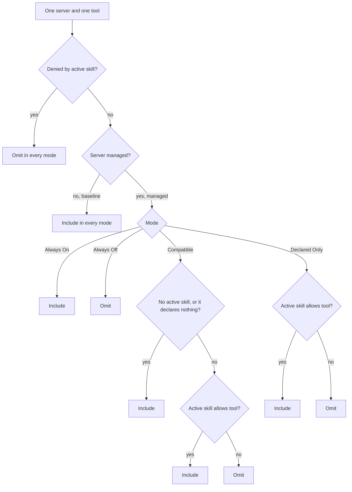
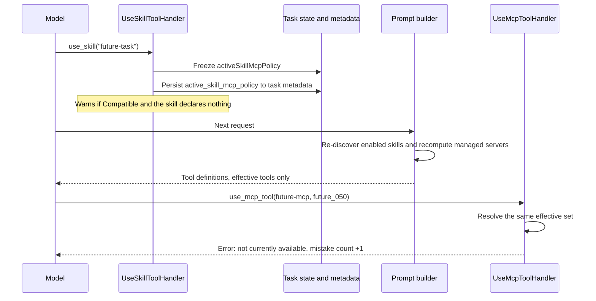
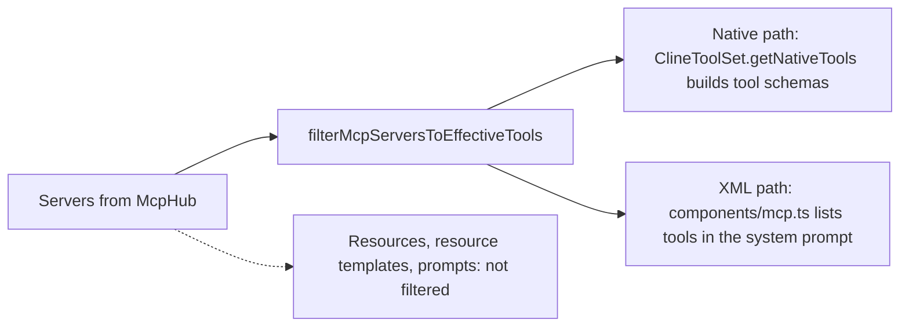

This guide explains the mechanics behind [Optional MCP Tools](/features/optional-mcp-tools). Read that page for setup. Read this one to predict exactly which tools a request sends, and why.

## At a glance

<Note>
Three rules decide everything:

1. A server is **managed** if any **enabled** skill names it in `allowed_mcp_tools` or `disallowed_mcp_tools`. Otherwise it is **baseline**.
2. **Baseline servers** are sent in full, in every mode.
3. **Managed servers** send only the tools the **active** skill allows (Declared Only), or fall back to everything (Compatible, when there is no active skill or the skill declares nothing), or nothing (Always Off).

A tool matched by the active skill's deny list is never sent.
</Note>

<Tip>
**Declaring one tool manages the whole server.** `allowed_mcp_tools: [agentmemory:search_notes]` makes all 54 agentmemory tools managed, not just `search_notes`.
</Tip>

## Vocabulary

| Term | Meaning | Where it comes from |
|---|---|---|
| **Enabled skill** | A skill that discovery returns and that is toggled on | `discoverAvailableSkills()` |
| **Active skill** | The one skill activated for this task with `use_skill` | `TaskState.activeSkillMcpPolicy` |
| **Managed server** | A server key that appears in any enabled skill's valid allow or deny entry | `managedServers` in `resolveEffectiveMcpTools()` |
| **Baseline server** | Any connected server no enabled skill names | Everything else |
| **Allowed tool** | Matched by the active skill's `allowed_mcp_tools` | `activeSkill.allowed` |
| **Denied tool** | Matched by the active skill's `disallowed_mcp_tools` | `activeSkill.disallowed` |
| **Declared** | The field is present in frontmatter, even as an empty list | `allowedDeclared`, `disallowedDeclared` |
| **noDeclarations** | There is no active skill, or it has neither field | `activeSkillHasNoDeclarations` |

## Configuration

### The setting

**Settings → Agent → Optional MCP Tools** has four values: Always On (default), Always Off, Dynamic — Compatible, and Dynamic — Declared Only.

| Plan/Act separate models | Value used |
|---|---|
| Off | The shared value, always |
| On, mode value set | The value for the current mode (Plan or Act) |
| On, mode value unset | The shared value |

### Skill frontmatter

```yaml
---
name: future-task
description: Task using three tools from the large server
allowed_mcp_tools:
  - future-mcp:future_000
  - future-mcp:future_001
  - future-mcp:future_002
disallowed_mcp_tools:
  - atlassian:jira_delete_*
---
```

A single string works in place of a list. A field present with an empty list (`allowed_mcp_tools: []`) is declared but references no server.

### How entries are read

Each entry is split on the **first** colon into `server` and `tool pattern`. The server part must equal the MCP server's config key exactly.

| Entry | Server | Tool pattern | Matches |
|---|---|---|---|
| `atlassian:jira_*` | `atlassian` | `jira_*` | `jira_get_issue`, `jira_delete_issue` |
| `atlassian:confluence_get_page` | `atlassian` | exact name | only `confluence_get_page` |
| `future-mcp:future_00*` | `future-mcp` | `future_00*` | `future_000` through `future_009` |
| `future-mcp-archive:x` | `future-mcp-archive` | `x` | never touches `future-mcp`, since the server key must match exactly |
| `agentmemory` | none | none | malformed (no colon): logged, ignored |
| `server:` | none | none | malformed (empty tool): logged, ignored |

The only wildcard is `*`, which matches any run of characters, including none. Server names have no wildcard.

## Classification

### Step by step



### Decision matrix

Rows are the active skill's state. Columns are the mode. Each cell applies to a **managed** server's tool that is not denied.

| Active skill state | Always On | Always Off | Compatible | Declared Only |
|---|---|---|---|---|
| No active skill | Include | Omit | **Include** | Omit |
| Active skill, no declarations (legacy) | Include | Omit | **Include** | Omit |
| Active skill allows this tool | Include | Omit | Include | **Include** |
| Active skill declares, does not allow this tool | Include | Omit | Omit | Omit |
| Active skill has deny-only entries | Include | Omit | Omit | Omit |
| Active skill has an explicit empty allow list | Include | Omit | Omit | Omit |

Two rows matter most:

- **Compatible** widens to everything only when the active skill declares nothing. A deny-only skill counts as declaring, so its managed server contributes only tools it allows: none.
- **Declared Only** never widens. Managed tools appear only when the active skill allows them.

For a **baseline** server, every mode includes every tool, unless the active skill denies it.

| Server kind | Always On | Always Off | Compatible | Declared Only |
|---|---|---|---|---|
| Baseline | Include | Include | Include | Include |
| Managed, tool denied by active skill | Omit | Omit | Omit | Omit |

### Why server-level

Per-tool classification let one large server leak. A skill allowing three of 250 tools left the other 247 baseline, so they were sent on every request. Classifying per server closes that gap. Undeclared servers stay intact, and the cost of a declaration is that it manages the whole server.

## Worked example

Four servers, one enabled skill. `future-task` allows three tools from `future-mcp`.

| Server | Tools | Referenced by an enabled skill? |
|---|---:|---|
| gnosis-mcp | 7 | No, baseline |
| agentmemory-mcp | 54 | No, baseline |
| atlassian-mcp | 63 | No, baseline |
| future-mcp | 250 | Yes, managed |

What gets sent in each scenario:

| Scenario | Gnosis | AgentMemory | Atlassian | Future | Total |
|---|---:|---:|---:|---:|---:|
| Declared Only, no active skill | 7 | 54 | 63 | 0 | **124** |
| Declared Only, `future-task` active | 7 | 54 | 63 | 3 | **127** |
| Always On, `future-task` active | 7 | 54 | 63 | 250 | 374 |
| Always Off, `future-task` active | 7 | 54 | 63 | 0 | 124 |
| Compatible, no active skill | 7 | 54 | 63 | 250 | 374 |
| Compatible, `future-task` active | 7 | 54 | 63 | 3 | 127 |

The model sees the 127 in the Declared Only row: the 124 baseline tools plus `future_000`, `future_001` and `future_002`. The other 247 Future definitions are absent from the request.

## Lifecycle of a task



Key point: the **active** policy is frozen when the skill activates. The **classification** is recomputed on every request from the currently enabled skills.

| Event | What happens | Notes |
|---|---|---|
| Task starts | No active policy | Baseline and managed servers are still classified from enabled skills |
| First `use_skill` | Policy frozen and persisted | A second `use_skill` returns an error; the first policy stays |
| Every request | Enabled skills rediscovered, managed set recomputed, mode re-resolved | Changing mode or the dropdown applies on the next request |
| Resume, skill still enabled | Snapshot restored | Frozen allows and denies are reused |
| Resume, skill disabled or removed | Snapshot dropped, warning logged | See the note below |
| Model calls a hidden tool | Rejected before the approval prompt | Counts toward consecutive mistakes |

<Warning>
**Disabling a skill changes classification for everyone.** Its declarations leave the enabled set, so a server only it referenced becomes **baseline** and is fully exposed again. A server still referenced by another enabled skill stays managed.
</Warning>

## Request paths

Both paths use one filter, so they cannot disagree.



| Path | Where | What is filtered | Notes |
|---|---|---|---|
| Native tool calling | `ClineToolSet.getNativeTools()` | Tool schemas in the `tools` array | Servers with `disabled: true` are dropped first, as before. Each tool name is `server uid + separator + tool name`. Names longer than 64 characters are dropped by existing code |
| XML / legacy | `components/mcp.ts` `getMcp()` | Tool list in the MCP section of the system prompt | Only connected servers are listed. Input schemas go with their tools |
| Execution check | `UseMcpToolHandler.checkToolAvailability()` | Calls to hidden tools are rejected | Same resolver, same inputs. Fast path when mode is Always On and nothing is denied |

<Note>
Hiding is about what the model is told about. It is not authorization. Auto-approve settings and the approval prompt are unchanged. Names of hidden tools can still appear in earlier messages or skill text.
</Note>

## Migrating existing skills

Declarations that worked per tool now have wider effects. Check this table before upgrading a configuration.

| Existing declarations | Before this change | After this change |
|---|---|---|
| Skill A allows `agentmemory:search_notes` | Only `search_notes` hidden in Declared Only; 53 others visible | All 54 agentmemory tools hidden unless the active skill allows them |
| Skill A allows `atlassian:jira_*`; skill B uses `confluence_get_page` without declaring it | `confluence_get_page` visible | Hidden while skill A is active, because Atlassian is managed |
| Deny-only `future-mcp:x` in Compatible | Everything except `x` visible | No `future-mcp` tools while that skill is active |
| Always Off, skill allows one tool of server S | Undeclared tools of S visible | All of S hidden, even with the skill active |

To keep a server usable across skills, either add its tools to every skill that needs them, or use Always On.

## Troubleshooting

| Symptom | Likely cause | Fix |
|---|---|---|
| Tool missing from a request | Its server is managed and the active skill does not allow it | Activate a skill that allows the tool, or allow it in the skill you use |
| Tool missing with no skill involved | Mode is Declared Only or Always Off, and some enabled skill names its server | Allow the tool in the skill that needs it, or switch to Always On |
| Savings never appeared | The pattern names a server key that does not match the config key, so the real server stays baseline | Check the config key, then the warning log for malformed entries |
| Whole server vanished after adding a skill | That skill names the server, so all of its tools are managed | Expected. Allow its tools in each skill that uses the server |
| Server reappeared after disabling a skill | The disabled skill was the only reference, so the server is baseline again | Expected. Re-enable the skill or keep another skill that names the server |
| Tool missing only in native mode | Native tool name exceeds 64 characters and is dropped by existing code | Shorten the server's uid or the tool name |
| Deny-only skill hides a whole server | Deny-only entries manage the server, and nothing is allowed | Add the tools you need to `allowed_mcp_tools`, or use Always On |

## Testing and verifying

| Test file | What it covers |
|---|---|
| `apps/vscode/src/shared/__tests__/mcpToolPolicy.test.ts` | Resolver: 124 and 127 scenario, every mode, Compatible fallback, deny precedence, cross-skill isolation, matching boundaries |
| `apps/vscode/src/core/prompts/system-prompt/__tests__/mcp-tool-visibility.test.ts` | Native schema and XML prompt contain exactly the three allowed Future tools |

Run the resolver tests from the extension directory:

```bash
cd apps/vscode
npx cross-env TS_NODE_PROJECT=./tsconfig.unit-test.json mocha --no-config --require ts-node/register --require tsconfig-paths/register --require ./src/test/requires.ts --timeout 20000 --exit src/shared/__tests__/mcpToolPolicy.test.ts
```

The prompt-level test imports generated protocol types. Generate them first:

```bash
cd apps/vscode
npm run protos
```

Then run it:

```bash
cd apps/vscode
npx cross-env TS_NODE_PROJECT=./tsconfig.unit-test.json mocha --no-config --require ts-node/register --require tsconfig-paths/register --require ./src/test/requires.ts --timeout 60000 --exit src/core/prompts/system-prompt/__tests__/mcp-tool-visibility.test.ts
```

### Not covered by automated tests

- The "disabled skill does not classify its server" rule is enforced by skill discovery, not the resolver. The resolver test only checks what happens when the caller passes no declarations.
- Resume and activation are exercised by code review, not by an automated test.

## File map

| Concern | File | Function or export |
|---|---|---|
| Resolver, classification, pattern matching | `apps/vscode/src/shared/mcpToolPolicy.ts` | `resolveEffectiveMcpTools`, `filterMcpServersToEffectiveTools`, `resolveMcpToolAvailability` |
| Frontmatter parsing | `apps/vscode/src/core/context/instructions/user-instructions/skills.ts` | `parseSkillMcpToolDeclarations` |
| Declaration accessors | `apps/vscode/src/shared/skills.ts` | `getSkillMcpToolDeclarations` |
| Prompt context (managed set input) | `apps/vscode/src/core/task/index.ts` | Prompt context build |
| Activation and freeze | `apps/vscode/src/core/task/tools/handlers/UseSkillToolHandler.ts` | `snapshotActiveSkillMcpPolicy` |
| Resume | `apps/vscode/src/core/task/index.ts` | `reconstructActiveSkillMcpPolicy` |
| Native tool schemas | `apps/vscode/src/core/prompts/system-prompt/registry/ClineToolSet.ts` | `getNativeTools` |
| XML / legacy prompt | `apps/vscode/src/core/prompts/system-prompt/components/mcp.ts` | `getMcp` |
| Execution check | `apps/vscode/src/core/task/tools/handlers/UseMcpToolHandler.ts` | `checkToolAvailability` |
| Setting keys | `apps/vscode/src/shared/storage/state-keys.ts` | `mcpToolAvailability` and the Plan/Act variants |
| Setting update paths | `apps/vscode/src/core/controller/state/updateSettings.ts` | Webview and CLI update paths |
| Settings UI | `apps/vscode/webview-ui/src/components/settings/sections/FeatureSettingsSection.tsx` | Optional MCP Tools dropdown |
| Feature reference | `docs/features/optional-mcp-tools.mdx` | Setup and reference |
